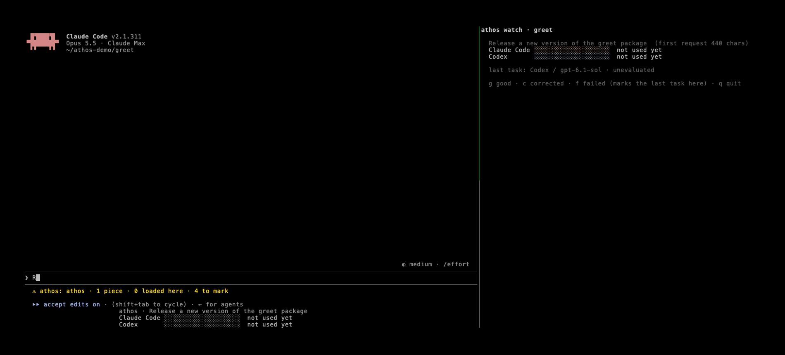

# Athos

Your AI know-how. Free to move, fast to run.

You teach AI agents how you do things every day: your steps, your conventions, the mistakes to avoid. Not only in code:
coding agents now do everyday work in any domain, writing code, running tools or controlling devices along the way.
That know-how stays locked in one agent and one chat. Athos keeps it as plain markdown on your machine, brings it to
the next agent (Claude Code, Codex, Muse Code) so you never explain it twice, and shows what each agent and model does
with it on your own tasks.

Why this should exist, and what isn't solved yet: [WHY.md](WHY.md).



*Claude Code learns once how this package is released. Codex then does the next release in the same folder with a
one-line request. Each bar: success over the tasks you marked, and how much shorter the request was than the first
time (real run, 17 s, waits cut).*

- **Captures and improves your know-how.** When a task in Claude Code teaches something reusable (your steps, your
  conventions, the mistakes to avoid), Athos saves it as a plain markdown file you can read and edit. Next time, only
  the pieces that match the request are loaded, and each reuse can improve them, with a version history.
- **Free to move.** The same know-how works in Codex, through its skills and hooks, from the one store on your
  machine. Nothing leaves your machine unless you move it.
- **Your own benchmark.** Benchmarks measure someone else's tests; Athos measures yours. Mark each task with one key,
  and `/athos:report` shows what every piece of know-how and every model brings to your own work.

## Install

In **Claude Code**, where Athos captures your know-how:

```
/plugin install athos --marketplace athos-agent/athos
```

In **Codex**:

```
codex plugin marketplace add athos-agent/athos
codex plugin add athos@athos
```

From a **terminal**, for **Muse Code** or anywhere without Claude Code:

```
curl -fsSL https://raw.githubusercontent.com/athos-agent/athos/main/install.sh | sh
athos export --muse          your pieces as skills Muse Code and Codex read
```

Requires Python 3.11+ (the installer picks the newest one you have). No other dependencies. Your know-how lives in
`~/.athos/know-how`, the same for every agent.

## Use

Athos works on its own: it loads matching know-how with each request and, after real work, offers to save what the
task taught. These are the commands you will reach for:

```
/athos:list          see your know-how and what is enabled
/athos:mark g        mark the last task: g good, c needed corrections, f failed
/athos:report        what each piece and each model brings to your work
/athos:codex         take your know-how to Codex
```

When a piece has proven itself, hand the task to a smaller, cheaper model: on your own machine through
[Ollama](https://ollama.com), or on Meta's models through Meta Model API (`--backend meta`, key in `MODEL_API_KEY` or
`~/.athos/.env`):

```
athos delegate <piece> "<request>"           runs in the current folder; asks before every command and write
athos delegate <piece> "<request>" --model qwen3.5:9b
athos delegate <piece> "<request>" --backend meta       muse-spark-1.3; --model muse-wonder-1.0 for the largest
```

The model follows the piece with four tools (run a command, read, edit and write a file), confined to the current
folder. The task lands in `/athos:report` as `local / <model>`, beside Claude Code and Codex, and you mark it like any
other. Nothing is delegated unless you run `athos delegate`. The default is `gemma4:12b`; in our tests a 4B model was
not enough for a release task, and the 12B one did it in about a minute and a half but still needed a correction.
`--yes` runs the model's commands without asking: use it only in a folder you can throw away.

To see what the know-how is worth before trusting a cheaper model with it, `athos bench` runs the same task several
times on each agent and model, with and without the know-how, and checks what each run left behind (git, the tests,
the files) instead of taking the agent's word:

```
athos bench --list                                         four cases: code, data, devices and a planning method
athos bench all --agents claude,meta,local --runs 5 --without --max-usd 5
athos bench report                                         success, time, tokens and cost per agent; the cheapest that keeps up
```

Each run gets a throwaway folder and its own Athos home, so your store and your recorded tasks stay untouched. Your own cases
(a folder with `case.json`, `piece.md`, `setup.py` and `check.py`, like the ones in `athos/bench/cases/`) go in
`~/.athos/bench/cases/` and never leave your machine.

Your know-how lives in `~/.athos/know-how/`, one markdown page per piece, as a wiki: each step is a statement
(when / do / because / links), the links follow the order things are done in a task, and `Index.md` says where each
kind of task starts. Walks that cross pages become subagents that improve with the pages. See [docs/WIKI.md](docs/WIKI.md). Choose what may load with
`/athos:load all | project <name> | pieces <id>... | none`, and copy everything out with `/athos:export <folder>`.

### In Codex

Athos is also a Codex plugin, reading the same store:

```
codex plugin marketplace add athos-agent/athos
codex plugin add athos@athos
```

The plugin brings the `athos` skill. In the Codex desktop app it also brings Athos's hooks; in the Codex CLI add them
once with `athos codex install` (Codex asks you to trust them with `/hooks`). Codex's footer takes no custom lines, so
run `athos watch` in a terminal beside it: one bar per agent for this project's know-how, the same bars Claude Code
shows under its prompt, marked with g / c / f.

### In Muse Code

Meta's coding agent reads the same skills as Codex, from `~/.agents/skills`:

```
athos export --muse
```

Athos records each Muse Code task from Muse's own session logs (no hooks to trust), with the model that answered and
the pieces it read, so `athos watch` and `/athos:report` show Muse Code beside Claude Code and Codex. Keep Muse Code's
Contributor mode off (`muse` → `/settings`) unless you want Meta to train on your sessions; Athos warns when a task
ran with it.

## Roadmap

- OpenCode.
- **Athos Cloud**: sync between your devices, a visual map of your know-how, daily control over what is shared, and an
  improvement agent as a service.

## License

Apache 2.0. See [LICENSE](LICENSE).
