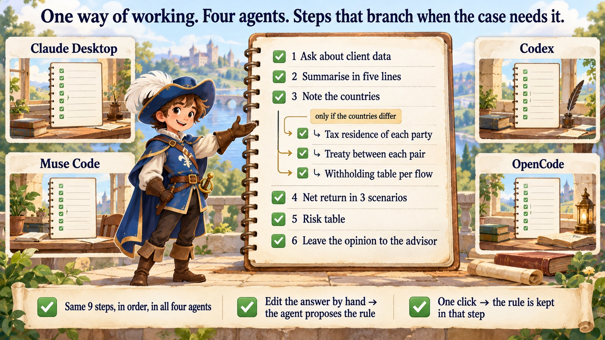
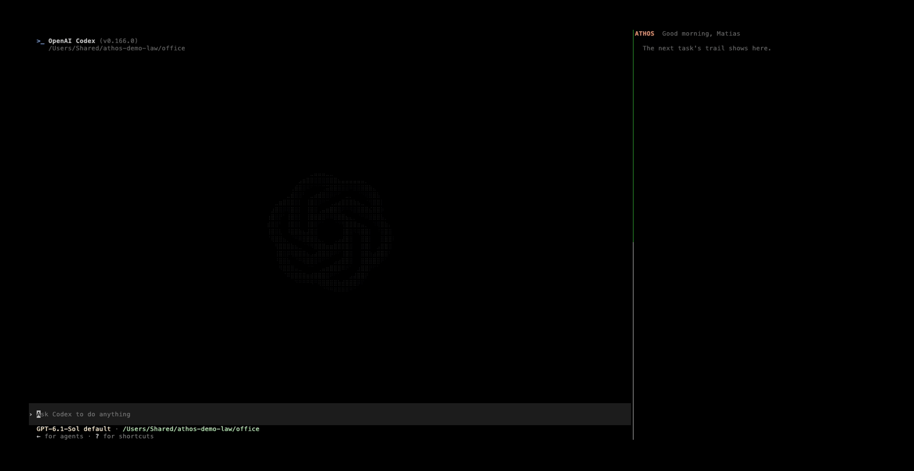

# Athos


Your AI know-how. Free to move, fast to run.

**Athos turns how you work (your criteria, your steps, your checklists) into a living, local and portable memory, so
any AI agent works by your rules without you explaining them twice.**

**Ask as you always do. Claude follows *your* way of working, and you watch it, step by step.**

![Claude Desktop (not the Code tab). An advisor pastes a fictional fund prospectus and asks to analyse the investment for a client, with no word about Athos. Athos's panel shows the advisor's own way of working as a page with nine steps. Because the investor, the asset and the vehicle are in three countries, the step "Note in which countries…" hands over to another way of working, the cross-border tax check, whose three steps appear nested under it. All nine tick in order as Claude works, and the answer ends by leaving the recommendation to the advisor.](demo/desktop-finance-en.gif)

*Claude Desktop, not the Code tab (fictional prospectus). An advisor asks to analyse an investment for a client, with
no word about Athos. Claude picks up the advisor's own way of working, "Analyse an investment with my committee's
rules", and Athos's panel shows it as a page with its steps ticked as Claude does them. One step hands over to
another way of working only when the case needs it: the investor is in Argentina, the warehouses in Texas and the fund
in Luxembourg, so the cross-border tax check runs right there, as nested steps (↳), and the walk comes back to the
numbers. The recommendation is left to the advisor. Waits are hidden, not sped up.
[A coach's week in the same panel](demo/athos-desktop-en.png) ([en español](demo/athos-desktop-es.png)).*



- **Your way, not a generic one.** Ask a lawyer's "review this lease" and the answer comes back with *their*
  five-line summary and *their* table: clause, problem, proposed wording, priority. Without it, the same request got
  a good, generic review.
- **You see the method, like a model's thinking.** Not tool calls: sentences, a page and a task list. **Change this
  step** improves your way of working on the spot; a task that needed new steps offers **Save as a way of working**.
- **It stays yours.** Plain markdown files in `~/.athos`, on your computer, that you can read and edit. The same know-how
  runs in Claude Code, Codex, Meta's Muse Code and OpenCode.

**In Codex, Muse Code and OpenCode too** (in OpenCode, in its own sidebar). The same way of working, followed in Codex from a one-line request, with
Athos's trail beside it ticking the steps as Codex reports them:



*Codex (fictional lease). No word about Athos in the request: Codex opens with the way of working it follows, reports
each step, and answers with the checklist's own table. Waits are hidden, not sped up.*

And in Meta's Muse Code on Muse Spark, a coach's rules for planning an athlete's week:


*Muse Code on Muse Spark (fictional athlete). In OpenCode the same trail sits in its sidebar, and **Athos: change this
step** and **Athos: save as a way of working** are in its command palette (ctrl+p).*

**Connectors: when a way of working needs a service.** A step of your way of working can need a service, and Athos
checks it on every request and shows it in the panel. The first one is [pii-guard](https://github.com/watt-mind/pii-guard),
which masks a client's personal data before the model and restores it in the answer: a lawyer's contract review in
OpenCode on Muse Spark went through it with every name, email and account masked, and the sidebar said *🔒 data through
pii-guard*. [How to use it](docs/guides/connectors.md) ([en español](docs/guides/conectores.md)).


*OpenCode on Muse Spark through pii-guard (fictional lease). The trail in OpenCode's sidebar; then **ctrl+p → Athos:
change this step**, and the lawyer's way of working gains a "legal basis" column, kept for next time.*

## The idea

Working with AI agents today is like hiring a brilliant intern with amnesia: every new chat, every new tool, you
explain your format, your checklist, your exceptions and the mistakes to avoid all over again. And what you taught
stays locked in one provider's cloud.

Athos is a **living operations manual** for your work. It picks up your know-how while you work, keeps it as plain
markdown files on your own computer, shows you, step by step, the agent following it, and lets you move it from an
expensive model to a cheap or local one, and check it keeps up.

- **From writing prompts to keeping your process.** You don't write prompts: you work with the agent and correct it,
  and Athos turns that into a way of working, with versions, that you reuse.
- **From tool calls to your own steps.** Instead of technical API calls, you see a task list of your own steps,
  ticked as the agent does them.
- **A small model with your know-how can do the job.** On our bench, Meta's Muse Spark went from 2 of 23 runs right
  without the know-how to 22 of 23 with it, at 8 to 24 times less per run than Claude Code.

Athos is a musketeer: free, and on its own two feet. The idea behind it, freedom and autonomy for what you know, is
very well told in this talk:

[](https://www.youtube.com/watch?v=eRrc1pUY5oU)

**Guides:** [Claude Desktop](docs/guides/claude-desktop-en.md) ([en español](docs/guides/claude-desktop.md)) · [for lawyers](docs/guides/lawyer.md) ([en español](docs/guides/abogado.md)) ·
[for coaches](docs/guides/coach.md) ([en español](docs/guides/entrenador.md)) ·
[your checklist is know-how](docs/guides/checklist-en.md) ([en español](docs/guides/checklist.md)) · why this should
exist and what isn't solved: [WHY.md](WHY.md).

## Your know-how moves, and it works where it lands

Teach a task once, in any of these tools, and the others follow it:

| Agent | How Athos plugs in | What we checked |
|---|---|---|
| **Claude Code** (and Claude Desktop's Code tab) | plugin | 21 of 21 bench runs good with the know-how |
| **Codex** | plugin | 20 of 20 bench runs good with the know-how |
| **Muse Code** (Meta) | the same plugin as Claude Code | a lawyer's contract review followed step by step; tokens from Muse's own log |
| **OpenCode** (any model) | plugin | the same review with Meta's Muse Spark; Athos asked, and Muse improved the piece |

In all four, the pieces that match a request are loaded and the agent opens by saying which of your ways of working it
follows and how it applies; every task is recorded with the model that answered; and after real work, or a task that
followed a checklist, Athos offers to save or improve a piece. A piece written in OpenCode loads in Claude Code the
next day.

In Claude Code, the band above the prompt says it in one place: which of your ways of working the task used, how it
has done so far and which words loaded it, with **Didn't apply** when it didn't fit (those words won't load it again);
**Save** when the task is worth keeping, so the AI is not asked after every task; and **Good / Corrected / Failed**.
Plain words count too: "ok excelente, …" marks the last task good. Only the last week's tasks wait for a mark.

**It starts to pay off on a cheaper model.** On five public bench tasks in five domains (code, data, devices, a
planning method, sports coaching), Meta's Muse Spark did 22 of 23 runs right with the know-how and 2 of 23 without it,
at 8 to 24 times less per run than Claude Code where we compared. Small cases written for the bench, 3 to 5 runs each;
[how to reproduce](docs/REFERENCE.md#use).

## For professionals, not only programmers

On first use, ask *"set up Athos for a lawyer"* (or *"para un entrenador"*): Athos adds example ways of working to
start from, in English or Spanish: **law** (build the argument of a brief, review a contract against your checklist), **sports coaching** (plan
the training week, write the post-match report), **engineering on call** (triage a production incident),
**journalism** (verify a lead before publishing), **science** (analyse an experiment so another lab can repeat it) and
**finance and tax advice** (analyse an investment with your committee's rules). They leave every professional decision to you and ask before
touching client, source or athlete data. No terminal needed: Claude Desktop's Code tab runs the plugin. Start with the
[overview for professionals](docs/PROFESSIONALS.md) ([en español](docs/PROFESIONALES.md)) or the guides above.

**Checklists are know-how.** When a task follows a checklist (you name it, paste it as a list, or the agent opens a
checklist file), Athos treats it as know-how worth keeping, even if the task only read and answered, and asks to save
it, or to improve the piece it used with your own items. [How it works](docs/guides/checklist-en.md).

## What else it does

- **Captures and improves your know-how.** Each piece is a plain markdown page you can read and edit, with a version
  history. Only the pieces that match a request are loaded, and each reuse can improve them.
- **Yours, and free to move.** Plain files in `~/.athos` that you can read, edit, version and copy. Nothing leaves
  your machine unless you move it.
- **Your own benchmark.** Benchmarks measure someone else's tests; Athos measures yours. Tell it how each task went,
  and ask *"what has my know-how brought?"*: every piece and every model, on your own work.
- **Hands mastered tasks to cheaper models.** Once a piece has proven itself, the task can run on a smaller model,
  local or hosted, and Athos's bench shows whether it keeps up.

## Get started

**Claude Desktop (the chat).** Download [athos.mcpb](https://github.com/athos-agent/athos/releases/latest/download/athos.mcpb),
double-click it and press **Install**; then upload [athos-skill.zip](https://github.com/athos-agent/athos/releases/latest/download/athos-skill.zip) in Customize → Skills and
open a new chat. Two minutes, no terminal:
[step by step](docs/guides/claude-desktop-en.md) ([en español](docs/guides/claude-desktop.md)).

**Claude Code, or Claude Desktop's Code tab.** Paste this one line and press Enter:

```
/plugin install athos --marketplace athos-agent/athos
```

**Codex, Muse Code and OpenCode.** One-time setup in the terminal: [Install](docs/REFERENCE.md#install).

## How to use it

No commands. You talk to the agent as you always do, in your own language.

1. **Teach a task once.** Do it with the agent the way you do it: your steps, your checklist, your format, your
   corrections. When it's done, press **Save as a way of working**, or just say *"save this as a way of working"*.
2. **Then just ask.** Next time, *"review this lease"* is enough. The answer opens with the way of working it follows,
   and the panel (Claude Desktop, Claude Code), the sidebar (OpenCode) or the trail beside the agent ticks its steps
   as they are done.
3. **Change it when you need to.** Press **Change this step** and write what changes, or simply say it: *"from now on,
   add a column with the legal basis"*. Your way of working is improved and kept for next time. If you fix by hand a
   file the agent wrote, it notices and proposes the rule: press **Keep this rule**. A task that needed new steps
   offers **Save as a way of working** again.
4. **Say how it went.** In the coding agents, *"great, thanks"* marks the task good and a correction marks it
   corrected. If a way of working didn't fit the request, press **Didn't apply** and it won't load for those words
   again.

You can also ask in plain words: *"what ways of working do I have?"*, *"show me my contract review"*.

Everything stays on your computer, in the `.athos` folder of your home, as plain text you can read and edit. The same
ways of working run in every agent. For terminal users, every command is in the [reference](docs/REFERENCE.md).

## Roadmap

- **Athos Cloud**: sync between your devices, a visual map of your know-how, daily control over what is shared, and an
  improvement agent as a service.

## Thanks

To the people whose ideas shaped Athos: see [WHY.md](WHY.md#thanks).

## License

Apache 2.0. See [LICENSE](LICENSE).
