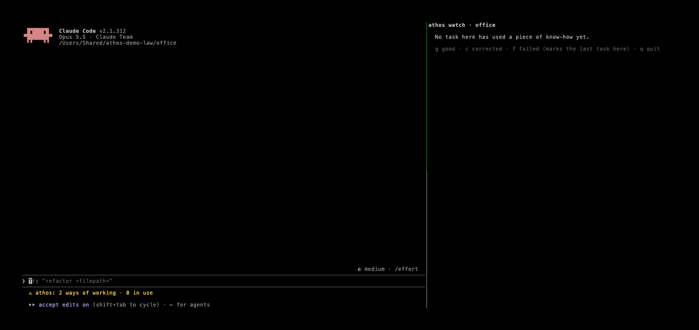

# Athos

Your AI know-how. Free to move, fast to run.

Every day you teach AI agents how you do things: your checklist, your steps, your format, the mistakes to avoid. Not
only in code: coding agents now do everyday work in any field, and a lawyer reviewing a contract or a coach planning a
week teaches them just as much. That know-how gets stuck in one chat of one tool. Athos keeps it as plain files on your
machine and carries it to every agent you use, **Claude Code, Codex, Meta's Muse Code and OpenCode**, so you never
explain it twice. On your own tasks, it shows what each agent and model does with it.

**Guides:** [for lawyers](docs/guides/lawyer.md) ([en español](docs/guides/abogado.md)) ·
[for coaches](docs/guides/coach.md) ([en español](docs/guides/entrenador.md)) ·
[your checklist is know-how](docs/guides/checklist-en.md) ([en español](docs/guides/checklist.md)) · why this should
exist and what isn't solved: [WHY.md](WHY.md).



*A lawyer reviews a lease in Claude Code with their checklist file, and Athos keeps it as a way of working. OpenCode,
on Meta's Muse Spark, then reviews a services agreement from a one-line request: it says which way of working it
follows and asks about client data before opening the file. Each bar on the right is one agent (real run, fictional
contracts, waits cut). En español: [demo/lawyer.gif](demo/lawyer.gif). The earlier release demo: [demo/athos-claude-to-codex.gif](demo/athos-claude-to-codex.gif).*

## Your know-how moves, and it works where it lands

Teach a task once, in any of these tools, and the others follow it:

| Agent | How Athos plugs in | What we checked |
|---|---|---|
| **Claude Code** (and Claude Desktop's Code tab) | plugin | 21 of 21 bench runs good with the know-how |
| **Codex** | plugin | 20 of 20 bench runs good with the know-how |
| **Muse Code** (Meta) | the same plugin as Claude Code | a lawyer's contract review followed step by step; tokens from Muse's own log |
| **OpenCode** (any model) | plugin | the same review with Meta's Muse Spark; Athos asked, and Muse improved the piece |

In all four, the pieces that match a request are loaded and the agent opens by saying which of your ways of working it
follows and how it applies; every task is recorded with the model that answered; and after real work, or a task that
followed a checklist, Athos asks once whether to save or improve a piece. A piece written in OpenCode loads in Claude
Code the next day.

**It starts to pay off on a cheaper model.** On five public bench tasks in five domains (code, data, devices, a
planning method, sports coaching), Meta's Muse Spark did 22 of 23 runs right with the know-how and 2 of 23 without it,
at 8 to 24 times less per run than Claude Code where we compared. Small cases written for the bench, 3 to 5 runs each;
reproduce with `athos bench all --without`.

## For professionals, not only programmers

`athos start` asks your language (English or Spanish) and your profession, and adds example ways of working to start
from: **law** (build the argument of a brief, review a contract against your checklist) and **sports coaching** (plan
the training week, write the post-match report). They leave every professional decision to you and ask before
touching client or athlete data. No terminal needed: Claude Desktop's Code tab runs the plugin. Start with the
[overview for professionals](docs/PROFESSIONALS.md) ([en español](docs/PROFESIONALES.md)) or the guides above.

**Checklists are know-how.** When a task follows a checklist (you name it, paste it as a list, or the agent opens a
checklist file), Athos treats it as know-how worth keeping, even if the task only read and answered, and asks to save
it, or to improve the piece it used with your own items. [How it works](docs/guides/checklist-en.md).

## What else it does

- **Captures and improves your know-how.** Each piece is a plain markdown page you can read and edit, with a version
  history. Only the pieces that match a request are loaded, and each reuse can improve them.
- **Yours, and free to move.** Plain files in `~/.athos` that you can read, edit, version and copy. Nothing leaves
  your machine unless you move it.
- **Your own benchmark.** Benchmarks measure someone else's tests; Athos measures yours. Mark each task with one key,
  and `/athos:report` shows what every piece of know-how and every model brings to your own work.
- **Hands mastered tasks to cheaper models.** Once a piece has proven itself, `athos delegate` runs the task on a
  smaller model, local or hosted, and `athos bench` shows whether it keeps up.

## Install

In **Claude Code** (or Claude Desktop's Code tab):

```
/plugin install athos --marketplace athos-agent/athos
```

In **Codex**:

```
codex plugin marketplace add athos-agent/athos
codex plugin add athos@athos
```

In **Muse Code**:

```
muse plugins marketplace add athos https://github.com/athos-agent/athos
muse plugins install athos@athos
muse plugins approve athos
```

In **OpenCode**, with the `athos` command from the installer:

```
curl -fsSL https://raw.githubusercontent.com/athos-agent/athos/main/install.sh | sh
athos opencode install       then restart OpenCode
```

Then `athos start` asks your language and profession and adds example ways of working (law and sports coaching today).

Requires Python 3.11+ (the installer picks the newest one you have). No other dependencies. Your know-how lives in
`~/.athos/know-how`, the same for every agent.

## Use

Athos works on its own: it loads matching know-how with each request and, after real work, offers to save what the
task taught. These are the commands you will reach for:

```
/athos:list          see your know-how and what is enabled
/athos:mark g        mark the last task: g good, c needed corrections, f failed
/athos:report        what each piece and each model brings to your work
/athos:codex         take your know-how to Codex
```

When a piece has proven itself, hand the task to a smaller, cheaper model: on your own machine through
[Ollama](https://ollama.com), or on Meta's models through Meta Model API (`--backend meta`, key in `MODEL_API_KEY` or
`~/.athos/.env`):

```
athos delegate <piece> "<request>"           runs in the current folder; asks before every command and write
athos delegate <piece> "<request>" --model qwen3.5:9b
athos delegate <piece> "<request>" --backend meta       muse-spark-1.3; --model muse-wonder-1.0 for the largest
```

The model follows the piece with four tools (run a command, read, edit and write a file), confined to the current
folder. The task lands in `/athos:report` as `local / <model>`, beside Claude Code and Codex, and you mark it like any
other. Nothing is delegated unless you run `athos delegate`. The default is `gemma4:12b`; in our tests a 4B model was
not enough for a release task, and the 12B one did it in about a minute and a half but still needed a correction.
`--yes` runs the model's commands without asking: use it only in a folder you can throw away.

To see what the know-how is worth before trusting a cheaper model with it, `athos bench` runs the same task several
times on each agent and model, with and without the know-how, and checks what each run left behind (git, the tests,
the files) instead of taking the agent's word:

```
athos bench --list                                         five cases: code, data, devices, a planning method, sports coaching
athos bench all --agents claude,meta,local --runs 5 --without --max-usd 5
athos bench report                                         success, time, tokens and cost per agent; the cheapest that keeps up
```

Each run gets a throwaway folder and its own Athos home, so your store and your recorded tasks stay untouched. Your own cases
(a folder with `case.json`, `piece.md`, `setup.py` and `check.py`, like the ones in `athos/bench/cases/`) go in
`~/.athos/bench/cases/` and never leave your machine.

Your know-how lives in `~/.athos/know-how/`, one markdown page per piece, as a wiki: each step is a statement
(when / do / because / links), the links follow the order things are done in a task, and `Index.md` says where each
kind of task starts. Walks that cross pages become subagents that improve with the pages. See [docs/WIKI.md](docs/WIKI.md). Choose what may load with
`/athos:load all | project <name> | pieces <id>... | none`, and copy everything out with `/athos:export <folder>`.

### In Codex

Athos is also a Codex plugin, reading the same store:

```
codex plugin marketplace add athos-agent/athos
codex plugin add athos@athos
```

The plugin brings the `athos` skill. In the Codex desktop app it also brings Athos's hooks; in the Codex CLI add them
once with `athos codex install` (Codex asks you to trust them with `/hooks`). Codex's footer takes no custom lines, so
run `athos watch` in a terminal beside it: one bar per agent for this project's know-how, the same bars Claude Code
shows under its prompt, marked with g / c / f.

### In Muse Code

Muse Code runs the same plugin as Claude Code: the pieces that match each request are loaded, every task is recorded
with the model that answered and its tokens (from Muse's own session log), and after a turn that changed something or
followed a checklist Athos asks once whether to save or improve a piece. `athos watch` and `/athos:report` show Muse Code beside Claude
Code and Codex. Keep Muse Code's Contributor mode off (`muse` → `/settings`) unless you want Meta to train on your
sessions; Athos warns when a task ran with it.

Without the plugin, `athos export --muse` writes your pieces as skills in `~/.agents/skills` and `athos import muse`
records past tasks from Muse's session logs.

### In OpenCode

Athos is an OpenCode plugin. Install it once:

```
athos opencode install       writes ~/.config/opencode/plugins/athos.js; restart OpenCode
```

With any model OpenCode runs, the pieces that match each message go into its system prompt, every task is recorded
with OpenCode's own token counts, and after a turn that changed something or followed a checklist Athos asks once
whether to save or improve a piece, as in Claude Code. `athos opencode uninstall` removes it.

### In Claude Desktop

In the **Code** tab, Claude Desktop runs Claude Code with the same settings, so the plugin works as it is, including
the lines under the prompt. For the regular **chat**, which takes MCP servers but not plugins, Athos serves your
know-how over MCP: add it in Settings → Developer → Edit Config (`claude_desktop_config.json`), with the absolute path
of the `athos` command (`command -v athos`, after `install.sh`):

```json
{ "mcpServers": { "athos": { "command": "/Users/you/.local/bin/athos", "args": ["mcp"] } } }
```

Restart Claude Desktop. The chat can then find the know-how for a request (`athos_find`, with the trajectory each piece
starts), show and list pieces, and save what a conversation taught (`athos_save`), into the same `~/.athos`.

### Inside a project, for any agent

`athos project sync` writes this project's know-how into `.athos/`, as plain markdown any agent reads without Athos
installed:

```
.athos/
  wiki/      Index.md (where a task starts), the pages, METHOD.md (how the pages and their trajectories were made)
  agents/    one subagent per trajectory, and AGENTS.md listing them
  skills/    one skill per page, and SKILLS.md listing them
  tools/     code the pages call when a step is a calculation, not a judgement
```

Each agent finds it where it already looks: `.claude/skills` and `CLAUDE.md` (Claude Code), `.agents/skills` and
`AGENTS.md` (Codex, Muse Code, OpenCode), `.claude/agents` and `.opencode/agents` (subagents). By default it picks the
pieces this project used or is tagged with (`--piece ID` or `--all` to choose), and adds itself to `.gitignore`: your
know-how stays yours even in someone else's repository, unless you share it with `--commit`. `athos project remove`
takes it all out again.

## Roadmap

- **Athos Cloud**: sync between your devices, a visual map of your know-how, daily control over what is shared, and an
  improvement agent as a service.

## Thanks

To the people whose ideas shaped Athos: see [WHY.md](WHY.md#thanks).

## License

Apache 2.0. See [LICENSE](LICENSE).
