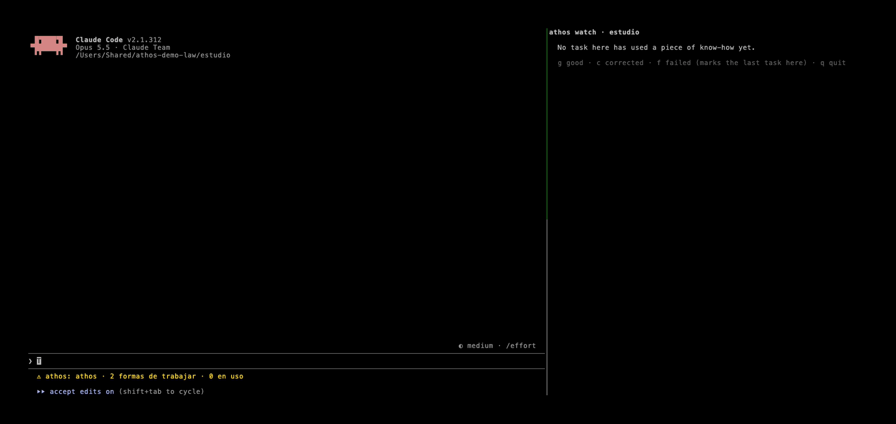

# Guía para abogados: tu forma de revisar contratos, en todas tus herramientas de IA

*English: [lawyer.md](lawyer.md)*

Esta guía es para quien ejerce y usa (o quiere usar) una IA para revisar contratos y armar escritos. No hace falta
programar. En media hora tenés tu checklist guardado como **forma de trabajar**, y cualquier herramienta de IA que uses
lo va a seguir sin que se lo vuelvas a explicar.



## Lo que vas a lograr

1. La IA revisa contratos **con tu checklist**, no con uno genérico: tus cláusulas, tu orden, tu tabla.
2. Lo explicás **una sola vez**. La próxima vez basta con *«revisá este contrato»*.
3. Lo mismo funciona en **Claude**, en **Muse Code de Meta**, en **OpenCode** (con el modelo que elijas) y en
   **Codex**. Tu know-how es tuyo y se mueve con vos.
4. Ves en cada tarea **qué forma de trabajar se usó** y la marcás: salió bien, la corregí o falló.

## 1. Instalar (10 minutos, sin terminal)

1. Instalá **Claude Desktop** y entrá con tu cuenta.
2. Creá una carpeta de prueba, por ejemplo `Contratos de prueba`, con un contrato **ficticio o anonimizado**.
3. En Claude Desktop abrí la pestaña **Code**, elegí esa carpeta y escribí:
   ```
   /plugin install athos --marketplace athos-agent/athos
   ```
   Reiniciá Claude Desktop cuando te lo pida.
4. Escribile a Claude: *«Corré `athos start --lang es --profile law`»*. Eso agrega dos formas de trabajar de
   ejemplo: **revisar un contrato con tu checklist** y **armar el argumento de un escrito**.

## 2. Tu primera revisión: enseñale tu checklist

Pedí como se lo pedirías a un colega, y la primera vez pegá tu propio checklist:

```
Revisá contrato-locacion.md con mi checklist. Represento al inquilino.
Mi checklist:
- partes, objeto, plazo, precio y forma de pago, ley y jurisdicción
- depósito: monto y condiciones de devolución
- rescisión anticipada y preaviso, para las dos partes
- reparaciones: qué es de cada uno
- penalidades, renovación automática, cesión
Devolveme una tabla: cláusula, problema, propuesta, prioridad.
```

Lo que vas a ver:

- La IA arranca con una línea como *«Sigo tu forma de trabajar "Revisar un contrato con tu checklist": primero los
  datos del cliente, después el resumen y la tabla de cláusulas.»* Así sabés qué método está aplicando.
- Antes de abrir el contrato te pregunta si tiene datos de clientes que no deberían salir de tu computadora.
- Mientras trabaja, debajo del cuadro de texto aparecen los pasos que sigue, en orden
  (`#datos_fuera → #partes_y_objeto → #clausulas_clave → #observaciones → …`).
- Al terminar, como la tarea siguió un checklist, Athos le pregunta a la IA si vale la pena guardarlo. Tu checklist
  queda como forma de trabajar: un archivo de texto tuyo, en tu computadora.

La segunda vez alcanza con: *«Revisá este contrato de servicios, represento al proveedor.»*

## 3. Marcá cómo salió

Después de cada tarea aparecen tres botones: **Salió bien**, **Lo corregí**, **Falló**. Tardás un segundo, y con esas
marcas Athos te muestra qué formas de trabajar te sirven y en qué herramienta (la barra debajo del cuadro de texto).
Si escribís «perfecto, ahora…» o «está mal…», Athos lo toma como marca.

Arriba del cuadro de texto Athos también te dice qué forma de trabajar usó, cómo le fue hasta ahora y por qué palabras
la eligió. Si no correspondía, tocá **No aplicaba**: con esas palabras no se vuelve a cargar. Y cuando una tarea vale la
pena, aparece **Guardar**: la forma de trabajar se guarda solo si vos querés.

## 4. Lo mismo, en tus otras herramientas

Tu checklist ya no está atado a Claude. Si usás o probás otras herramientas, instalá Athos una vez en cada una (lo
hace quien te ayude con la computadora, o vos desde una terminal):

| Herramienta | Cómo se instala |
|---|---|
| Comando `athos` (lo necesitan las de abajo) | `curl -fsSL https://raw.githubusercontent.com/athos-agent/athos/main/install.sh \| sh` |
| **Muse Code** (Meta) | `muse plugins marketplace add athos https://github.com/athos-agent/athos`, después `muse plugins install athos@athos` y `muse plugins approve athos` |
| **OpenCode** (cualquier modelo) | `athos opencode install` y reiniciar OpenCode |
| **Codex** | `codex plugin marketplace add athos-agent/athos` y `codex plugin add athos@athos` |

En cada una pedís lo mismo (*«revisá este contrato con mi checklist»*), la IA sigue tu forma de trabajar y Athos
registra la tarea. Lo probamos con el mismo contrato ficticio en Muse Code y en OpenCode con Muse Spark, el modelo de
Meta: las dos siguieron el checklist (resumen en cinco líneas, tabla de cláusulas, la decisión en manos del abogado).

## 5. Secreto profesional

- **Tus formas de trabajar no salen de tu computadora.** Athos no tiene servidor ni cuenta.
- **La IA sí ve lo que le mostrás.** Con datos de clientes: anonimizá nombres, documentos y montos, o usá un modelo que
  corre en tu computadora sin internet (`athos delegate` con [Ollama](https://ollama.com)).
- **Muse Code:** dejá apagado el modo *Contributor* (`/settings`).
- La IA propone y vos decidís: las formas de trabajar de ejemplo no son asesoramiento legal y le piden a la IA que
  pregunte en vez de decidir.

## 6. Hacelo tuyo

Tus formas de trabajar están en `~/.athos/know-how`, una por archivo. Abrilas con cualquier editor (o con
[Obsidian](https://obsidian.md)) y escribí tu manera: el orden en que mirás las cláusulas, los riesgos que siempre
buscás, el formato de tu tabla. Cada cambio guarda la versión anterior. Si algo no te sirve, borralo.

¿Dudas, ideas o un caso que te gustaría ver? Abrí un issue en
[github.com/athos-agent/athos](https://github.com/athos-agent/athos/issues).
